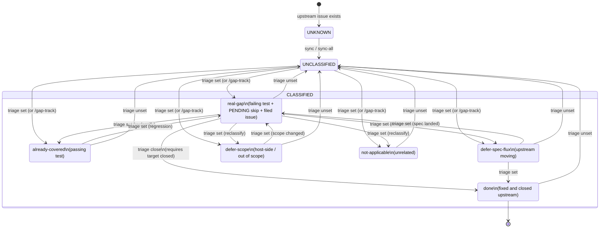

# gap-tracker — state machine & developer flows

gap-tracker tracks issues from upstream reference repos ("sources") that might
map to missing capabilities in our own project ("target"). Each source issue
flows from "never seen" → "classified" → "resolved", and the `main.py` CLI is
the interface for every transition.

This doc is the **design anchor** for the CLI shape. If a flow you want isn't
here, either the flow is missing from the tool or the doc needs to be updated.

## Architecture

- **Source of truth**: the SQLite database (`<project>/gaps.db`). Every verb
  that changes state writes the DB directly.
- **YAML snapshots** (`<project>/triage.snapshot.yaml`): generated on demand
  via `triage export`, committed to git for point-in-time review. YAML is
  never read back except via the rare `triage import` path.
- **Config** (`<project>/config.json`): declares sources, target repo, and
  `target_path` (local checkout of the target repo where repro tests live).

## State machine



## Verbs → transitions

| Verb | Reads | Writes | Notes |
|---|---|---|---|
| `sync <src>:<off>` | GH API | `issues` | Pulls one source or target |
| `sync-all <project>` | GH API | `issues` | Pulls every source + target |
| `show <project> <ref>` | `issues`, `triage`, `gaps` | — | Read-only per-issue detail |
| `triage status <project>` | `issues`, `triage` | — | Per-source counts + unclassified list |
| `triage list <project>` | `issues`, `triage` | — | Grouped view, filters by `--bucket` / `--source` |
| `triage set <ref> <bucket> [target] "rationale"` | `issues` | `triage` | Upsert; idempotent; bumps `updated_at` |
| `triage unset <ref>` | `triage` | `triage` | Delete |
| `triage close <ref>` | `issues`, `triage` | `triage` | Requires target CLOSED; flips bucket to `done` |
| `triage export [--out path]` | `triage` | file | YAML snapshot for git |
| `triage import <path>` | file | `triage` | Bulk upsert from YAML (rare reverse path) |
| `triage verify <project>` | `triage`, `target_path` | — | **Stub today.** Runs pinned tests, flags drift |
| `/gap-track mcpkit <ref>` | everything | everything | Full validate → file → set pipeline |

`triage set` is the low-level workhorse. `/gap-track` is the opinionated
slash command that runs the full tests-first pipeline (write failing test,
confirm fail, file GH issue, add `PENDING:` skip, call `triage set`).

## Side effects per bucket

Classification is always just a DB row write. The **surrounding workflow**
differs per bucket — this is what `/gap-track` automates and what you'd do
manually with `triage set`:

| Bucket | Test file | Filed issue | `test:` field |
|---|---|---|---|
| `real-gap` | **failing**, with `t.Skip("PENDING: ...")` as first line | **yes**, new mcpkit# | populated |
| `already-covered` | **passing**, new or pre-existing | no | populated |
| `defer-spec-flux` | — | no | empty |
| `defer-scope` | — | no | empty |
| `not-applicable` | — | no | empty |
| `done` | whatever was there when it was real-gap; skip line should be deleted as part of the fix PR | target closed | populated |

## Entry points (how a developer actually uses it)

### 1. Starting a session — "where was I?"

```bash
cd ~/newstack/gap-tracker
uv run python main.py triage mcpkit status
```

Shows per-source counts + any UNCLASSIFIED items. If every open issue is
classified, you're caught up. If not, the unclassified rows are your work list.

### 2. Upstream landed new issues overnight

```bash
uv run python main.py sync-all mcpkit
uv run python main.py triage mcpkit status   # now shows new unclassified items
```

For each new item, use the slash command to run the full pipeline:

```
/gap-track mcpkit <source>:<N>
```

It'll show the issue, write a failing repro test, file the mcpkit issue, add
the `PENDING:` skip to the test, and write the triage row — all in one go.

### 3. Picking up a real-gap to implement

```bash
uv run python main.py triage list mcpkit --bucket real-gap
```

Each row has a `test:` field pointing at a file and function inside
`target_path`. Open the file, find the test, delete the
`t.Skip("PENDING: ...")` line, run the test, observe the original failure.
Implement the fix until the test passes. Commit the fix + the un-skip
together as part of your PR.

### 4. You merged the fix; the mcpkit issue auto-closed

```bash
uv run python main.py sync mcpkit target:0     # pull the closed state
uv run python main.py triage close mcpkit <source>:<N>
```

`triage close` verifies the target is actually CLOSED in the DB before
flipping the bucket to `done`. It refuses otherwise, so you can't mark a
gap done by accident.

### 5. Reclassifying (you were wrong, or circumstances changed)

```bash
uv run python main.py triage set mcpkit <source>:<N> <new-bucket> [target] "updated rationale"
```

Idempotent. Overwrites the existing row. `classified_at` stays pinned to the
original classification date; `updated_at` bumps so `triage list` can sort by
staleness.

### 6. Commit a snapshot of current classifications

```bash
uv run python main.py triage export mcpkit --out mcpkit/triage.snapshot.yaml
git -C ~/newstack/gap-tracker add mcpkit/triage.snapshot.yaml
git -C ~/newstack/gap-tracker commit -m "chore(triage): snapshot $(date +%Y-%m-%d)"
```

YAML snapshots are git-visible history of what the DB held at a point in
time. Not required for correctness — useful for "when did we reclassify X?"
forensics.

### 7. Drift check (v2 — not built yet)

```bash
uv run python main.py triage verify mcpkit
```

Will run each pinned test in `target_path`, compare pass/fail to bucket, and
flag mismatches (e.g. a `real-gap` test that now passes without being closed,
or an `already-covered` test that now fails).

## Schema (the interesting parts)

```sql
-- issues: every GH issue we've synced from any repo (source or target)
CREATE TABLE issues (
    repo TEXT NOT NULL,
    number INTEGER NOT NULL,
    title TEXT,
    state TEXT,           -- "OPEN" or "CLOSED"
    labels TEXT,
    body TEXT,
    notes TEXT,           -- JSON array of {text, at} — free-form
    synced_at TEXT,
    PRIMARY KEY (repo, number)
);

-- triage: one row per source issue we've classified
CREATE TABLE triage (
    repo          TEXT NOT NULL,
    number        INTEGER NOT NULL,
    bucket        TEXT NOT NULL,
    target        TEXT,             -- e.g. "mcpkit#190" or ""
    rationale     TEXT,
    test          TEXT,             -- "path::TestName"
    classified_at TEXT NOT NULL,    -- ISO date, never moves after first set
    updated_at    TEXT NOT NULL,    -- ISO date, bumps on every change
    PRIMARY KEY (repo, number),
    FOREIGN KEY (repo, number) REFERENCES issues(repo, number)
);

-- gaps: legacy feature → target_issue mapping, kept for link/mark/report
CREATE TABLE gaps (
    feature TEXT PRIMARY KEY,
    target_issue INTEGER,
    source_evidence TEXT,
    status TEXT,
    priority INTEGER
);
```

`triage` and `gaps` coexist because they have different grains:

- `triage` is per (source_repo, source_number) — one row per upstream issue.
- `gaps` is per feature — one row per local capability, with source_evidence
  listing all refs that map to it.

Under normal use you'll only touch `triage`; `gaps` survives for legacy
`link`/`mark`/`report` commands and as the bridge from older triage runs.

## Invariants

- Every classified row in `triage` has a matching row in `issues` (FK
  constraint).
- A `real-gap` row SHOULD have both `target` (a filed issue) and `test` (a
  failing repro); the slash command enforces this, manual `triage set` does
  not.
- A `done` row SHOULD have `target` pointing at a CLOSED issue in the
  `issues` table; `triage close` enforces this, manual `triage set` does not.
- `triage.snapshot.yaml` is **generated**. Edit it only if you know
  `triage import` will overwrite your changes and you're about to run it.
